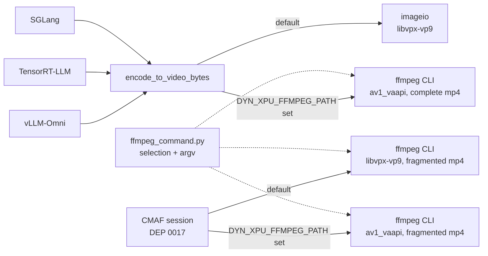

# Optional Intel AV1 Hardware Encoding for Generated Video

**Status**: Draft

**Authors**: Sergey Plotnikov

**Category**: Architecture

**Replaces**: N/A

**Replaced By**: N/A

**Sponsor**: [Name of code owner or maintainer to shepard process]

**Required Reviewers**: [Names of technical leads that are required for acceptance]

**Review Date**: [Date for review]

**Implementation PR / Tracking Issue**: [To be filed]

# Revision note

An earlier revision of this DEP, "Unified Video Encoder", proposed a new shared
entry point (`encode_video()`), per-backend frame converters, and the hardware
encoder in one change. Review split that up:

* The consolidation that was actually missing — SGLang onto the shared batch
  encoder the other two backends already used — landed on its own in
  [ai-dynamo/dynamo#11121](https://github.com/ai-dynamo/dynamo/pull/11121). No
  new entry point and no converters were needed.
* CMAF streaming is DEP 0017
  ([ai-dynamo/dynamo#15171](https://github.com/ai-dynamo/dynamo/pull/15171)),
  software-only.
* What remains for this DEP is the hardware encoder, for both paths, on top of
  those two.

# Summary

Dynamo encodes generated video with software VP9 (`libvpx-vp9`), the only video
encoder its runtime images carry. This DEP adds an **optional hardware encoder
for Intel GPUs**: AV1 over VA-API (`av1_vaapi`), selected at deployment time by
pointing `DYN_XPU_FFMPEG_PATH` at a VA-API-capable ffmpeg.

One switch covers both video outputs:

* the batch route, `/v1/videos`, for all three backends (vLLM-Omni,
  TensorRT-LLM, SGLang), because they share one encoder function;
* the CMAF streaming route, `/v1/videos/stream/cmaf` (DEP 0017).

With the variable unset nothing changes: the software path is not touched.

# Motivation

The shipped images carry no royalty-bearing encoder. Upstream PR #11836 removed
H.264, including `h264_nvenc`, and added a build-time gate
(`container/compliance/`) that fails the build if one returns, so the in-tree
ffmpeg encodes VP9 in software and nothing else.

On an Intel GPU that leaves the media engine idle while the CPU encodes. AV1 is
the way to use it without reopening the licensing question: it is royalty-free,
and current Intel GPUs encode it in hardware. H.264 and H.265 stay excluded in
hardware form too — the GPU can encode them, but offering them would put a
royalty-bearing codec surface back into a distributed product. VP9 is not an
option: on the Arc Pro B60 this was validated on, the driver exposes VP9 for
decode only.

For streaming there is a second consideration. The CMAF path runs libvpx at
its fastest setting (`-deadline realtime -cpu-used 8`), which is a
speed-for-quality trade made so that software encoding does not hold segments
back. The hardware encoder needs no such setting.

## Goals

* Hardware encoding on Intel GPUs without a royalty-bearing codec.
* One deployment-time switch for the batch route and the streaming route.
* No silent fallback in either direction.
* The software default unchanged, and the change revertible on its own.

### Non Goals

* Shipping a VA-API ffmpeg or an Intel media driver in any image. Both are
  supplied by the operator.
* Capability auto-detection.
* Any codec or container choice exposed to the caller or the request.
* Hardware encoders of other vendors; software AV1; H.264 or H.265 in any form.
* Changes to the frontend, the request schema, or the CMAF wire format. The
  CMAF metadata frame already carries the codec string of the stream.

# Proposal



## Selection and configuration

Two environment variables, read where the encode happens:

| Variable | Meaning | Default |
|---|---|---|
| `DYN_XPU_FFMPEG_PATH` | Path to an ffmpeg built with VA-API and `av1_vaapi`. Its presence is the only encoder switch. | unset → software VP9 |
| `DYN_XPU_VIDEO_DEVICE` | DRM render node of the GPU that encodes. Read only when hardware is selected. | `/dev/dri/renderD128` |

Selection is deliberately **not** auto-detected. `ffmpeg -encoders` lists VA-API
wrappers the driver cannot run — `vp9_vaapi` lists cleanly and then fails at
runtime with "No usable encoding entrypoint found" — so probing yields false
positives. The operator declares hardware support by setting the path.

On a host with several GPUs the render node is not derived from the device the
model runs on; the operator sets both. They can name the same GPU or different
ones.

## The two encoders

| | Default | Hardware |
|---|---|---|
| Encoder | `libvpx-vp9`, software | `av1_vaapi`, Intel VA-API |
| Selected when | `DYN_XPU_FFMPEG_PATH` is unset | `DYN_XPU_FFMPEG_PATH` names an executable |
| Batch route driven by | imageio → the image's LGPL ffmpeg | the operator's ffmpeg, via CLI, raw frames on stdin |
| Streaming route driven by | the image's LGPL ffmpeg, via CLI | the operator's ffmpeg, via CLI |
| Container | mp4 | mp4 |
| Pixel format | yuv420p | yuv420p (`nv12` on the VA-API surface) |

The CLI is required for the hardware batch path because imageio's ffmpeg plugin
does not expose VA-API device selection or hardware filter chains
(`format=nv12,hwupload`).

## Command construction

Selection and argv construction live in one new module,
`dynamo/common/utils/ffmpeg_command.py`. One builder produces the argv for the
batch hardware encode and for the streaming session with either encoder, so the
codec identity, the VA-API upload and the quality setting are decided in one
place.

Batch, hardware:

```
ffmpeg -vaapi_device $DYN_XPU_VIDEO_DEVICE \
       -f rawvideo -pix_fmt rgb24 -s WxH -r FPS -i - \
       -vf format=nv12,hwupload \
       -c:v av1_vaapi -global_quality 25 \
       -movflags +faststart -f mp4 OUT.mp4
```

Streaming, hardware:

```
ffmpeg -vaapi_device $DYN_XPU_VIDEO_DEVICE \
       -f rawvideo -pix_fmt rgb24 -s WxH -r FPS -i - \
       -vf format=nv12,hwupload \
       -c:v av1_vaapi -global_quality 25 -g 8 -keyint_min 8 -async_depth 1 \
       -movflags +frag_keyframe+empty_moov+default_base_moof \
       -flush_packets 1 -f mp4 pipe:1
```

| Argument | Why |
|---|---|
| `-vf format=nv12,hwupload` | moves the frames onto the VA-API surface; `nv12` is 4:2:0, which the encoder consumes and players expect |
| `-global_quality 25` | set explicitly so output does not depend on the driver's built-in default; 25 is that default today |
| `-async_depth 1` | streaming only: the encoder queues frames before returning packets, which would hold a finished fragment back |

The software streaming argv of DEP 0017 is produced by the same builder and is
unchanged; a test pins it.

## Batch path

`encode_to_video_bytes()` resolves the switch first. When hardware is selected
it pipes the frames to the declared ffmpeg and reads the result back from a
temporary file — mp4 with `+faststart` needs a seekable output. Otherwise it
runs the existing imageio code, which this DEP does not modify.

Two contracts are stricter on the hardware path, because raw bytes carry no
shape or type and anything else would encode as garbage rather than fail:

* frames must be `np.ndarray (T, H, W, 3) uint8`;
* the container must be `mp4`, the only one every handler accepts today.

## Streaming path

The CMAF session resolves the same switch when it starts. Everything else in
DEP 0017 is unchanged: the process model, chunking, the box-header cutter, the
wire format, the lifecycle.

The codec string in the metadata frame is read from the init segment's `av1C`
box (`av01.P.LLT.DD`), exactly as the VP9 one is read from `vpcC`, so a client
that follows DEP 0017 — check `MediaSource.isTypeSupported()` on the metadata's
`mime_type`, then append — plays the AV1 stream with no change.

## Error handling

Every failure is raised, and **no failure falls back to the other encoder**.

| Condition | Result |
|---|---|
| `DYN_XPU_FFMPEG_PATH` set but not an executable file | `RuntimeError` naming the variable and both alternatives |
| Hardware selected and frames are not `(T, H, W, 3) uint8` | `ValueError`, before any process starts |
| Hardware selected and the container is not mp4 | `ValueError`, before any process starts |
| Hardware ffmpeg exits non-zero | `RuntimeError` including its stderr; on the CMAF route, the terminal `error` frame |
| Hardware ffmpeg exits zero but writes nothing, or exceeds the time limit | `RuntimeError` |

The no-fallback rule is the load-bearing decision. A silent downgrade from
hardware to software would hide a deployment error behind an unexplained change
in encode cost and in the codec clients receive: the operator asked for hardware
encoding and should hear that they did not get it.

## Operational requirements

* The worker can open the render node.
* The Intel media driver on the worker supports AV1 encoding on that GPU:
  `vainfo --display drm --device <node>` lists
  `VAProfileAV1Profile0 : VAEntrypointEncSlice`.
* Frames are at least the hardware's minimum size. On an Arc Pro B60 that is
  128x96; a smaller clip fails with ffmpeg's own message.

Validated on an Arc Pro B60 with Ubuntu 24.04's ffmpeg 6.1.1 and
`intel-media-va-driver-non-free` 26.3.5 and 26.4.1.

## The software default is unchanged

* The software branch of `encode_to_video_bytes()` is not edited.
* A test pins the software streaming argv to the one DEP 0017 shipped.
* With the variable unset, a test asserts that no ffmpeg process is started on
  the batch path.
* The tests of #11121 and #15171 pass without modification, apart from one
  constant that a test now reads from its new module.
* On the validation host, the batch and CMAF end-to-end checks were repeated
  with the variable unset.

## Tests

No encoder started, no GPU:

| Area | What it checks |
|---|---|
| Selection | unset and blank mean software; an executable selects hardware; a missing or non-executable path raises and does not select software; render-node default and override |
| Command construction | exact argv for hardware batch and hardware streaming; the software streaming argv unchanged; no libvpx options reach `av1_vaapi` |
| Batch, against a stand-in ffmpeg | the declared binary receives the raw frames and the VA-API arguments; non-zero exit raises with stderr; no output raises; non-mp4 and non-uint8 input are refused before any process starts; imageio is never imported |
| Streaming | the session runs the declared hardware binary; an encoder failure names the hardware encoder; `av1C` parses to the codec string; the AV1 fallback string applies when the init segment cannot be read |

Against a real VA-API encoder, running only where `DYN_XPU_FFMPEG_PATH` is set:

| Area | What it checks |
|---|---|
| Batch | AV1, yuv420p, every frame, `moov` before `mdat`, decoded picture matches the input |
| Streaming | fragments decode to every frame; each segment decodes with only the init segment; sequence numbers and decode times are continuous; a 17-frame clip ends in a 1-frame segment; segments arrive while input is still being written; the codec string is `av01.0.*.08` |

The hardware tests never probe: they run where the operator declared an
encoder, and skip everywhere else.

# Alternate Solutions

## Alt 1 — Auto-detect the hardware encoder

Probe `ffmpeg -encoders` and use hardware when it appears available.

**Reason rejected:** the probe is unreliable. Advertised VA-API wrappers fail at
runtime on drivers that do not implement them, so auto-detection produces
confident false positives and an unpredictable encoder per host.

## Alt 2 — Fall back to software when the hardware encode fails

**Reason rejected:** it turns a deployment error into a silent change of codec
and encode cost. On the streaming route it is not even possible after the init
segment has gone out, because the client is already decoding against that
codec configuration.

## Alt 3 — Expose codec and container per request

**Reason rejected:** which encoders exist is a property of the deployment. A
codec parameter would be a promise a deployment may not be able to keep, and it
would make the response format depend on the request.

## Alt 4 — Ship a VA-API ffmpeg in the Intel runtime image

**Reason deferred:** it would make the feature work out of the box, but it adds
an ffmpeg with a larger codec surface to an image that the compliance gate
restricts to one LGPL build, and it ties the image to a media-driver version.
That is a packaging decision for a follow-up; the encoder code does not depend
on it.

## Alt 5 — A separate hardware encoder module per path

**Reason rejected:** the batch and streaming paths differ only in output target,
GOP and muxer flags. Two builders would let the codec identity, the upload
filter and the quality setting drift apart.
