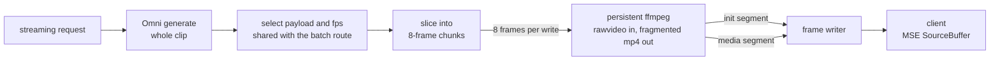

# CMAF Streaming for Dynamo Video Generation

**Status**: Draft

**Authors**: Sergey Plotnikov

**Category**: Architecture

**Replaces**: N/A

**Replaced By**: N/A

**Sponsor**: [Name of code owner or maintainer to shepard process]

**Required Reviewers**: [Names of technical leads that are required for acceptance]

**Review Date**: [Date for review]

**Implementation PR / Tracking Issue**: [ai-dynamo/dynamo#15171](https://github.com/ai-dynamo/dynamo/pull/15171)

# Prior Art

This DEP builds on an **unmerged** proof of concept by @jpohl-nv, on two branches
of `ai-dynamo/dynamo`:

| Branch | PR | Contribution |
|---|---|---|
| `jpohl/streaming-poc` | #8606 | The original end-to-end CMAF streaming prototype |
| `jpohl/streaming-cmaf-minimal` | #8616 | The same path reduced to a minimal CMAF implementation |

**Neither PR was merged.** Nothing from them is on `main`, so this work is a
first landing rather than a refactor of shipped code, and the POC cannot be
treated as a compatibility constraint.

The POC is nonetheless the source of this design's load-bearing choices, and they
are adopted deliberately rather than rediscovered: one long-lived ffmpeg per
request producing fragmented MP4 on a pipe, a separate route as the only trigger
for CMAF output, and binary length-prefixed frames instead of base64 over SSE.
Where this DEP departs from the POC it says so explicitly — the POC assembled the
presentation timeline on the client with `SourceBuffer.timestampOffset`, and this
design moves it into the muxer (see [Timeline](#timeline) and
[Alt 2](#alt-2--assemble-the-timeline-on-the-client)). Every later reference to
"the POC" in this document means these two branches.

Separately, the MJPEG route `POST /v1/videos/stream` (#6487, also from @jpohl-nv,
shipped in v1.0.0) is the existing streaming precedent in the frontend. The CMAF
route is its sibling, not its replacement.

# Summary

Video generation today is request/response: the client waits for the entire clip
to be generated, encoded, and persisted before it receives anything. This DEP
adds a **streaming entry point** that emits a CMAF fragmented-MP4 stream —
an init segment followed by media segments — so a browser can start playing after
the first segment instead of after the whole clip.

**What streams is the encode and the delivery, not the generation.** The engine
still returns the whole clip; this DEP starts encoding it as soon as it is
available and hands each half-second segment to the client as it completes,
instead of encoding the whole clip, persisting it, and returning it in one piece.

The stream is software VP9 (`libvpx-vp9`), the codec the batch route already
produces, so this DEP adds no codec and no new dependency: it runs the ffmpeg
the runtime images already ship. It stands alone. Hardware AV1 encoding is a
separate proposal (DEP 0016, revised to sit on top of this one) and nothing here
depends on it.

# Motivation

For the test vehicle — Wan2.1-T2V at its defaults, 97 frames at 16 fps,
832×480, about six seconds of video — the client currently sees nothing until
generation, encoding, and the storage write have all completed.

Two things follow from streaming the encode:

* **Today**, the wait after generation shrinks from "encode and store the whole
  clip, then transfer it" to "encode the first half-second". That is a modest
  gain, because generation still dominates the wait.
* **Later**, once vLLM-Omni can emit frames during generation, only the *source*
  of the frames changes; the chunking, encoding, and delivery path in this DEP
  is unchanged, and the first segment becomes playable long before the last
  frame exists.

The second point is the main reason to build this now, and the main constraint
on how it is built.

## Goals

* Deliver a playable CMAF stream while encoding is still in progress.
* Produce a stream whose timeline is authored by the muxer, not reconstructed by
  the client.
* Keep `/v1/videos` and `/v1/videos/stream` exactly as they are, whatever a
  client puts in the request.
* Fail legibly: a stream that fails ends with an explicit error, never with a
  truncated video that looks complete.
* Keep the design unchanged when frames later arrive incrementally.

### Non Goals

* Any change to the vLLM-Omni project. It is called as the batch route calls it,
  and returns the whole clip. Dynamo's own Omni integration — the handler, stage
  router, and output formatter under `dynamo/vllm/omni/` — does change.
* Hardware encoding. Software VP9 only; see DEP 0016.
* Audio. Single video track only. Generated audio is logged as not carried.
* Per-chunk generation. Chunking happens after the clip is received.
* SGLang and TensorRT-LLM workers. Their video handlers do not implement the
  stream yet; the route reports that explicitly (see Error handling).
* Changes to the batch encoder, `encode_to_video_bytes()`.
* A DASH or HLS manifest, multiple renditions, or ABR.

# Proposal

Dynamo-side only. A **separate streaming entry point** —
`POST /v1/videos/stream/cmaf` — is what selects CMAF output; the existing routes
keep their current behaviour. Requesting that endpoint is the trigger; there is no
request field or env var that switches any other route's output shape (see
[Route selection](#route-selection)).



## Relation to the batch route

| | Batch (`/v1/videos`) | CMAF (`/v1/videos/stream/cmaf`) |
|---|---|---|
| Codec | VP9, `libvpx-vp9` | the same |
| Which output is the video, and its frame rate | `_resolve_video_outputs()` in the formatter | the same function |
| Encoder front end | imageio, `encode_to_video_bytes()` | ffmpeg CLI, driven directly |
| Process model | one shot, returns when the file is complete | one long-lived process per request |
| Output | a complete mp4, read back after the encode | `pipe:1`, read while encoding |
| Muxing | plain mp4 | fragmented: `+frag_keyframe+empty_moov+default_base_moof` |
| Keyframes | encoder default | `-g 8 -keyint_min 8`, aligned to segment boundaries |
| Encoder arguments | unchanged by this DEP | low-latency arguments, see Encoder session |
| Response protocol | untagged payload | one optional CMAF tag field; see Transport |

The batch encoder is not touched. The streaming encoder and the MP4 parsing live
in their own module, `dynamo/common/utils/cmaf_encoder.py`, with the wire
vocabulary (tags, chunking, metadata) in `dynamo/common/utils/cmaf_video.py`.

Sharing `_resolve_video_outputs()` is deliberate: the two routes must agree on
which engine output is the video and at what rate it plays, including a clip the
engine returns only in `multimodal_output['video']` and a frame rate it reports
in its metadata.

The stream is selected by formatter type, exactly as the batch route selects its
formatter, so a diffusion stage is streamed whether the engine labels its output
`image` or `video`.

## Route selection

The CMAF route marks the request it forwards with an internal flag,
`extra_args["cmaf_stream"] = true`, and the worker streams only when it sees it.

`extra_args` is the worker-boundary field of the video request, not a public
one: the frontend never deserializes it from a request body, and every unknown
field a client sends is nested one level down, under
`extra_args["media_passthrough"]`. So nothing a client sends — an `nvext`
annotation, a top-level `cmaf_stream`, its own `extra_args` — can turn the
stream on for `/v1/videos` or `/v1/videos/stream`. Each route gets CMAF output
only by setting the flag itself, so there is no list of routes that must
remember to strip something.

An earlier revision used an `nvext.annotations` entry as the trigger. That field
is public, which made it a second, undocumented way to request CMAF output on
the ordinary routes, where the JSON aggregator would have returned the init
segment and fragments as separate video entries.

## Chunking

Eight frames per segment — 500 ms at 16 fps — overridable with
`DYN_CMAF_GOP_FRAMES`, whose value **must be a positive multiple of four**.

Eight rather than four because each segment carries a keyframe: a 250 ms segment
doubles keyframe density to buy a start-up latency no viewer distinguishes from
500 ms.

The multiple-of-four requirement is about how frames will arrive once generation
streams, and it is worth stating precisely, because it is not boundary
coincidence. Wan2.1's VAE is causal with a temporal stride of 4: `num_frames` is
`4n + 1`, the first latent frame decodes to a single pixel frame, and every later
one decodes to four. Frames therefore arrive as 1, 4, 4, 4, …, and cumulative
arrival boundaries fall at `4m + 1` — never on a multiple of 4. Segment
boundaries at multiples of 8 never coincide with one, so the phase is off by a
frame permanently. What holds instead:

* **The rate matches.** A segment consumes exactly two arrival groups in steady
  state. The first consumes three: 1 + 4 + 4 = 9 frames, of which it uses 8.
* **The phase does not, and that is harmless.** One frame is always carried into
  the next segment — constant, never growing.
* **Latency is unaffected.** A segment ends at frame `8k`, and `8k + 1` is an
  arrival boundary, so each segment is ready the moment its final arrival group
  lands.

A segment size that is not a multiple of four loses only the first property: the
carry begins to vary — 3, 1, 3, 1 … for a 6-frame segment — instead of staying at
one frame. So the requirement buys a constant buffer, not aligned boundaries.
Nothing in the encoder command changes either way; keyframes at multiples of the
segment size are what `-g` already produces. The requirement is enforced where the
value enters the process, when `DYN_CMAF_GOP_FRAMES` is read.

Making the first segment 9 frames would align the phase, but it needs forced
keyframes at `8k + 1` rather than a constant GOP, and saves one frame of buffer
while latency is already minimal.

The permanent one-frame offset surfaces at the end of the clip: 97 frames gives
twelve 8-frame segments and a **1-frame final segment**. Requests are not obliged
to use the model default — `num_frames` may come from `seconds × fps` — so the
chunker must handle any remainder, and that degenerate tail is the interesting
test case rather than the happy path.

## Encoder session

One ffmpeg process per request, frames written 8 at a time, fragments read off
stdout as they complete:

```
ffmpeg -f rawvideo -pix_fmt rgb24 -s WxH -r FPS -i - \
       -c:v libvpx-vp9 -g 8 -keyint_min 8 \
       -deadline realtime -cpu-used 8 -lag-in-frames 0 -auto-alt-ref 0 \
       -row-mt 1 -pix_fmt yuv420p \
       -movflags +frag_keyframe+empty_moov+default_base_moof \
       -flush_packets 1 -f mp4 pipe:1
```

`-g 8` places a keyframe at each boundary and `-frag_keyframe` cuts the fragment
there, so segment length is ours rather than an ffmpeg heuristic.

The low-latency arguments apply to this path only; the batch encoder keeps its
current arguments exactly:

| Arguments | Why |
|---|---|
| `-deadline realtime -cpu-used 8` | at 832×480 the libvpx default encodes six seconds of video in appreciably more than six seconds, which makes streaming pointless as a latency feature |
| `-lag-in-frames 0 -auto-alt-ref 0` | libvpx looks ahead 25 frames by default, so finished fragments are withheld regardless of encode speed |
| `-row-mt 1` | row-level threading, to recover some of the quality budget `-cpu-used 8` spends |
| `-pix_fmt yuv420p` | from rgb24 input libvpx picks 4:4:4, which is VP9 profile 1, and browser MSE support for `vp09.01` is not dependable |

| Variable | Meaning | Default |
|---|---|---|
| `DYN_FFMPEG_PATH` | The ffmpeg binary. Needed because this path drives the CLI directly instead of going through imageio. | `/usr/local/bin/ffmpeg` |
| `DYN_CMAF_GOP_FRAMES` | Frames per segment; a positive multiple of four (see Chunking). Also sets `-g` / `-keyint_min`. | `8` |

> `/usr/local/bin/ffmpeg` is the LGPL build the runtime images ship and the only
> ffmpeg location the codec-compliance policy permits. Its allowlist already
> contains everything this command needs: the `rawvideo` demuxer and decoder,
> the `libvpx-vp9` encoder, the `mp4` muxer, and the `pipe` and `fd` protocols.
> Images lacking it cannot serve the CMAF route.

## Timeline

The timeline is authored **server-side, by ffmpeg**. Because one muxer sees every
frame, `tfdt.baseMediaDecodeTime` and `mfhd.sequence_number` are continuous and
there is exactly one `moov`, with no post-processing of the bitstream by us.

This is a deliberate reversal of the POC, which assembled the timeline on the
client with `SourceBuffer.timestampOffset`. That worked for video alone and broke
audibly once audio was added: segment durations for the two tracks do not divide
evenly, so per-segment offsets accumulated a mismatch that was perceptible at
boundaries. Correct A/V interleaving on one timeline is a muxer's job, and
reconstructing it outside the muxer — on the client or by patching boxes on the
server — is the failure this design removes. Audio is out of scope here, but the
timeline decision is what keeps it reachable.

Our only bitstream work is *reading*: parse top-level box headers on stdout to
find segment boundaries, and split the leading `ftyp`+`moov` into the init
segment. No box is modified.

## Transport

`POST /v1/videos/stream/cmaf` in the Rust frontend, with the binary framing the
POC already uses: each frame is `[kind: u8][length: u32 big-endian][payload]`.

| Kind | Frame | Payload | When |
|---|---|---|---|
| `0x01` | `metadata` | JSON: `mime_type`, `video_codec`, `width`, `height`, `fps`, `target_duration`, `segment_count` | once, first frame on the stream |
| `0x02` | `init` | `ftyp` + `moov` | once, before any media |
| `0x03` | `segment` | one `moof` + `mdat` | per chunk |
| `0x04` | `error` | UTF-8 message | on failure, immediately before `done` |
| `0x05` | `done` | — | last frame on every stream that reached the body |

Binary rather than base64-over-SSE: segments are already compressed, and base64
would add a third to every byte on a latency-motivated path.

The worker does not write frames. It returns ordinary video responses carrying one
new optional field — a CMAF tag, `cmaf:metadata`, `cmaf:init`, or
`cmaf:segment:{n}` — and the route maps each tag to its kind byte and emits the
framing. Only that internal worker → frontend hop is base64, because it is JSON;
the client-facing bytes are binary, which is the whole point of the framing. Adding
an optional field keeps the response type readable by frontends that predate CMAF.

The `metadata` frame exists because the MSE codec string is not a constant: the
VP9 level in it depends on the resolution and frame rate, and it would name a
different codec altogether once another encoder is added. It is read from the init
segment's own sample entry (`vpcC`), falling back to `vp09.00.10.08` if that parse
fails so the client always has something to pass to
`MediaSource.isTypeSupported()`, which it must call before appending.
`segment_count` is known today only because the whole clip is generated before
chunking; it is nullable, and becomes null once generation streams, so a client must
key end-of-stream off the `done` frame either way.

## Client

`examples/custom_backend/cmaf_binary_video_streaming/` carries the reference
client:

| File | Role |
|---|---|
| `client.html` | Browser MSE player: reads the frames, checks `isTypeSupported()` against the metadata mime type, appends init then segments to one `SourceBuffer` |
| `cmaf_client.py` | Headless client: same framing, reassembles to a file, for testing without a browser |
| `run_proxy.py` | Serves the page and forwards the API on a single origin |
| `README.md` | How to run the three of them |

The proxy is there for a real constraint rather than for convenience: the Dynamo
frontend sends no CORS headers, so a page served from `file://` or any other origin
cannot read the stream at all. Same-origin delivery is a requirement for any
browser client of this route, not a property of this example.

## Error handling

Two regimes, split by whether anything has been committed to the wire. The split is
**not** at the init segment, and the distinction matters: the status line and
headers are written when the response body is constructed, before any frame exists,
so everything after that point is a 200.

| When | Behaviour |
|---|---|
| Before the engine stream starts — malformed body, frontend not ready, unknown model, engine refuses the request | ordinary HTTP error; nothing has been committed |
| After — any worker or encoder failure, *including one that happens before the init segment* | terminal `error` frame carrying a message, then `done`; the client surfaces the failure and calls `endOfStream()` |

`done` follows `error` rather than replacing it so that the last frame of a stream
is unconditional and a reader always sees a well-formed tail. `error` is
authoritative: a client that has seen it stops there and does not treat the
following `done` as success.

A bare end-of-stream is never acceptable after a failure: it is
indistinguishable from success, so a fault at segment 9 of 13 would silently
deliver a truncated video that looks complete. The same reasoning covers a worker
that does not implement CMAF at all: it ignores the flag and returns ordinary
untagged responses, which would otherwise produce an empty but successful stream, so
the route counts what it emitted and substitutes an explicit `error` frame naming
the likely cause when nothing was tagged. That is the N-2 mixed-version obligation
in `lib/llm/AGENTS.md` — a new frontend against an older worker must fail
legibly rather than silently.

The message in the `error` frame is the frontend's client-safe text for the
failure, the same text an HTTP error body would carry (for an encoder crash,
"Internal server error"). The diagnostic — ffmpeg's exit code and the tail of its
stderr — goes to the worker and frontend logs, not to the client.

There is no fallback, before or during the stream. There is one encoder, and once
the init segment has gone out the client is decoding against its codec
configuration, so a chunk failure aborts the stream.

## Process lifecycle

The persistent process is the one part of this that must be written carefully:

* **Three pipes are pumped concurrently.** Writing stdin while ffmpeg blocks on a
  full stdout pipe deadlocks, so stdout and stderr are drained by background
  tasks for the life of the process.
* **One process per in-flight request**, reaped on every exit path.
* **A disconnected client stops the encode.** By the time the stream starts,
  generation has finished, so nothing else is watching the request: the encode
  session itself observes the request context and tears the process down when
  the client goes away. Without that, ffmpeg outlived a disconnected client by
  about ten seconds in testing.
* **Teardown kills the process group.** ffmpeg is started in its own group and
  teardown signals the group, because `DYN_FFMPEG_PATH` may name a wrapper
  script. Killing only the wrapper leaves the real encoder running and holding
  the pipes — and asyncio's `Process.wait()` does not return until the pipes
  close, so the request would hang as well.
* **Every wait on the process is bounded**: writing a chunk, flushing at end of
  input, reading a fragment, and waiting for exit all time out, and a timeout
  tears the session down and fails the stream.
* **Mid-stream failure** appears as a non-zero exit with stderr captured
  separately. Both are logged; the client gets the `error` frame described above.

## Tests

Unit tests, no encoder started and no GPU required:

| Area | What it checks |
|---|---|
| Chunk slicing | 97 frames → 12 + 1, the single-frame tail, every frame covered in order, exact multiples leave no tail, a non-positive size is rejected |
| Segment length | the default, a blank value treated as unset, an override, and rejection of anything that is not a positive multiple of four; segment seconds follow the frame rate |
| Wire vocabulary | segment tags are 1-based; the metadata payload carries the codec string as a `mime_type` MSE accepts, the geometry, and a nullable `segment_count` |
| Route selection | only the route's own flag selects the stream; an annotation, a top-level field, and a client `extra_args` do not, in the Rust request type and in both workers |
| Command construction | raw RGB in, fragmented MP4 out, `-g` / `-keyint_min`, the low-latency and browser-playable arguments |
| Codec string | `vpcC` → `vp09.PP.LL.DD` parsed out of a synthetic init segment; another codec, a missing sample entry, and a truncated init fall back |
| Segment framing | a fragmented-MP4 byte stream splits into one `init` and N `segment` frames at exact boundaries, byte-at-a-time feeding included, unknown top-level boxes skipped, the tail flushed, an impossible box size rejected |
| Frame framing | every worker tag maps to its kind byte and an unknown tag is skipped; the length prefix is big-endian and correct for an empty, small, and large payload; a failed stream and a stream with no tagged frame both end in `error` then `done`; a backend error is reported without its diagnostic |
| Formatter and workers | metadata precedes init precedes segments; `image`- and `video`-labelled outputs both stream; payload and frame rate match what the batch route would encode; a failure produces a failed response, not a bare end; the encoder is closed when a push raises and when the request is cancelled |

Against a stand-in process, to pin the failure and lifecycle behaviour:

| Area | What it checks |
|---|---|
| Failure | non-zero exit raises with the exit code and stderr; a process that stops reading, stalls at end of input, or produces nothing is killed after the I/O timeout |
| Cancellation | closing the session mid-stream, and cancelling the task that drives it, both reap the process; a wrapper script's child process dies with it |

Against a real ffmpeg, skipped when none with `libvpx-vp9` is present:

| Area | What it checks |
|---|---|
| Round trip | the fragments decode to every input frame, and each segment decodes with only the init segment |
| Timeline | `mfhd.sequence_number` and `tfdt.baseMediaDecodeTime` are continuous across segments |
| Tail | a 17-frame clip ends in a 1-frame segment |
| Streaming | fragments are delivered while input is still being written |

Verified by hand against a live aggregated worker (Wan2.1-T2V-1.3B), with the
in-tree ffmpeg build the runtime images ship:

| Area | Result |
|---|---|
| Stream | 17, 33, and 97 frames give 3, 5, and 13 segments; init plus segments decode to VP9 profile 0, yuv420p, every frame |
| Pacing | with the encoder held to the native frame rate, a segment reaches the client every 0.5 s while the encode is still running |
| Isolation | `/v1/videos` with the old annotation and the flag as a top-level field returns one complete, unfragmented mp4 |
| Lifecycle | a client killed mid-stream leaves no ffmpeg behind, also behind a wrapper script; an encoder killed mid-stream ends the stream with `error` then `done`; an unknown model is an HTTP 404 before any frame |
| Browser | the reference player plays the stream through the same-origin proxy |

Not covered end to end: the stage-router (disaggregated) path, which has unit
tests only. There is no disaggregated video launch script on `main` to run it
with.

# Alternate Solutions

## Alt 1 — One ffmpeg invocation per chunk

**Reason rejected:** every invocation produces a self-contained file, so
`tfdt.baseMediaDecodeTime` restarts at 0, `mfhd.sequence_number` restarts at 1,
and each chunk carries its own `ftyp`+`moov`. Continuous server-side timestamps
would therefore require us to write an MP4 box rewriter — strip, patch, renumber
— which is more code and more risk than pumping three pipes, and reintroduces the
hand-authored timeline that this design exists to remove. It also pays a process
spawn and VA-API context init per segment and loses prediction across boundaries.

**Note:** it does not even buy fidelity to the future design. What is incremental
in per-chunk generation is the *input*; a persistent process is incremental on
both ends, and no final implementation would respawn ffmpeg thirteen times
mid-generation.

## Alt 2 — Assemble the timeline on the client

Send self-contained fragments and advance `SourceBuffer.timestampOffset`.

**Reason rejected:** this is what the POC did. It works for video-only and
produces perceptible audio distortion at segment boundaries once a second track
exists. See Timeline.

## Alt 3 — imageio for the software path

**Reason rejected:** `imwrite()` into a buffer returns only when encoding has
finished, so fragments cannot be read as they emerge. This holds even though
`output_params` can pass `-movflags` through — the blocker is the API's
completion semantics, not its flag surface. Driving the CLI directly also means a
hardware encoder can later be added as a different argument list on the same
process model, rather than as a second mechanism.

## Alt 4 — Base64 segments over the existing SSE route

**Reason rejected:** a third more bytes on a path whose entire purpose is
latency, and it overloads a route whose response shape is already specified.
A separate entry point is also the cleanest trigger for CMAF output.

## Alt 5 — Status quo

**Reason rejected:** keeps time-to-first-frame tied to the whole clip and leaves
no transport for per-chunk generation to land on.
